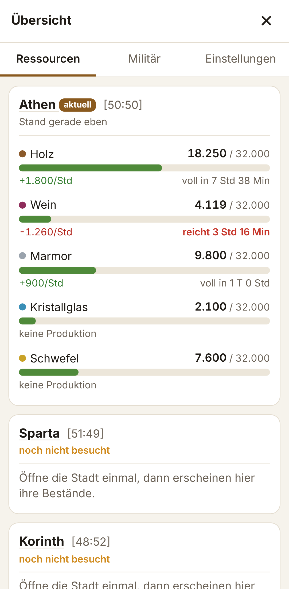
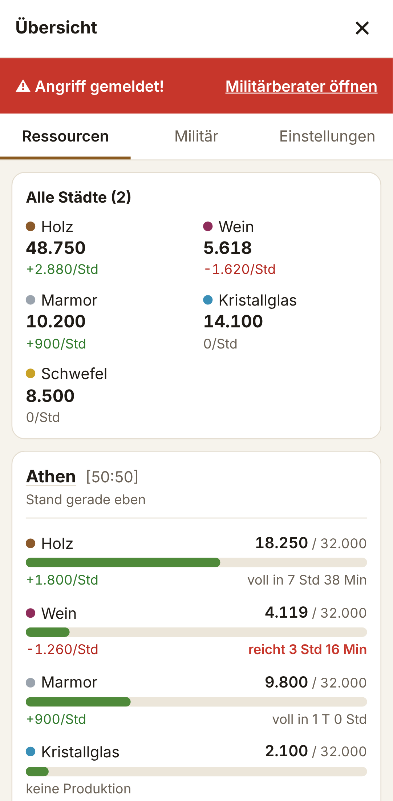
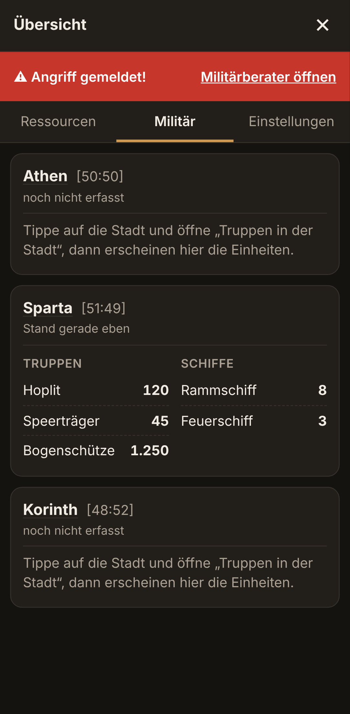
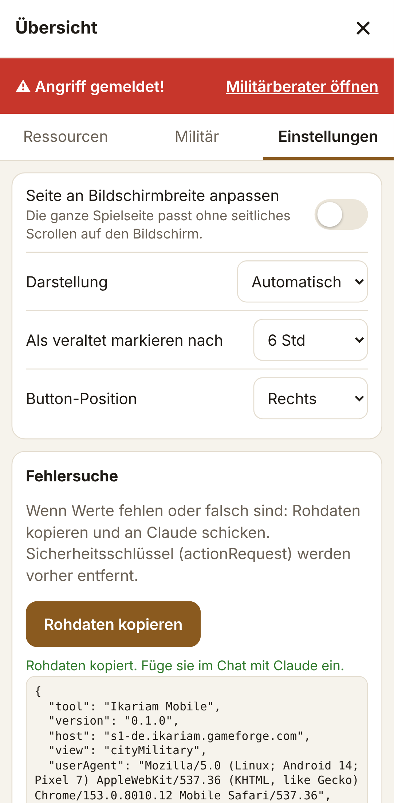

# Ikariam Mobile

Eigene, fürs Handy gebaute Erweiterung für Ikariam. Sie zeigt auf einen Blick:

- **Ressourcen**: alle Städte als Karten mit Lagerbestand (hochgerechnet bis jetzt), Füllstandsbalken
  (rot ab 90 %), Produktion pro Stunde, „voll in …“ und „Wein reicht noch …“, plus Summe über alle Städte.
- **Militär**: Truppen und Schiffe pro Stadt und gesamt, roter Hinweis bei gemeldetem Angriff.
- **Seite an Bildschirmbreite anpassen**: Schalter in den Einstellungen gegen das ständige Zoomen.

> **Nur lesen und anzeigen.** Das Skript liest ausschließlich Daten, die Ikariam ohnehin an deinen
> Browser schickt, und schickt selbst keine Anfragen. Es führt keine Spielaktionen aus (Bots verstoßen
> gegen die Gameforge-Regeln). Ein Tipp auf eine Stadt ist ein ganz normaler Spiel-Link.

| Ressourcen | Nach Stadtwechsel mit Angriff | Militär (dunkel) | Einstellungen |
|---|---|---|---|
|  |  |  |  |

*(Screenshots aus der Testseite mit Beispieldaten.)*

## Installation auf dem Handy (Lemur Browser)

1. In Lemur den **Chrome Web Store** öffnen und **Tampermonkey** installieren.
2. Diese Adresse öffnen:
   `https://raw.githubusercontent.com/Silverback42/ikariam/HEAD/ikariam-mobile/dist/ikariam-mobile.user.js`
   Tampermonkey bietet die Installation an → **Installieren**.
3. Ikariam öffnen. Unten rechts erscheint ein runder Button. Einmal durch alle Städte wechseln,
   dann ist die Ressourcen-Übersicht gefüllt. Für die Militär-Übersicht je Stadt einmal
   „Truppen in der Stadt“ öffnen (oder in der Militär-Karte auf den Stadtnamen tippen).
4. ikaeasy kann parallel aktiv bleiben oder auf dem Handy deaktiviert werden.

**Updates** holt Tampermonkey automatisch über `@updateURL`. Dafür muss dieses Repo **öffentlich** sein.
Ist es privat, funktioniert die Raw-Adresse nicht: Dann die Datei `dist/ikariam-mobile.user.js` aufs Handy
laden und in Tampermonkey über *Hilfsprogramme → Aus Datei importieren* installieren (und bei neuen
Versionen genauso aktualisieren).

### Alternative: als Erweiterung laden

`dist/ikariam-mobile-extension.zip` (bzw. der Ordner `dist/extension/`) ist eine Manifest-V3-Erweiterung
mit demselben Code. In Lemur unter Erweiterungen den Entwicklermodus einschalten und die .zip bzw.
den entpackten Ordner laden. Updates gibt es auf diesem Weg nur von Hand.

## Wenn etwas nicht stimmt: Debug-Export

Ikariams interne Feldnamen konnten beim Bauen nicht am echten Spiel geprüft werden. Falls Werte fehlen
oder falsch sind:

1. Panel öffnen → **Einstellungen** → **Rohdaten kopieren** (oder **Teilen**).
2. Den Text an Claude schicken. Sicherheitsschlüssel wie `actionRequest` werden vorher entfernt.
   Enthalten sind Stadtnamen, Bestände und die letzten Spielantworten.

Am meisten hilft ein Export direkt nach einem Stadtwechsel und einer direkt nach dem Öffnen von
„Truppen in der Stadt“.

## Entwicklung

Kein Bundler, keine Abhängigkeiten (nur Node ≥ 18; Playwright für die Vorschau).

```bash
cd ikariam-mobile
npm run build     # dist/ neu erzeugen (nach jeder Änderung an src/ und vor dem Commit!)
npm test          # Berechnungen und Parser mit Fixtures (node --test)
npm run preview   # Mock-Seite im Pixel-7-Profil, Prüfungen + Screenshots nach docs/screenshots/
```

| Datei | Aufgabe |
|---|---|
| `src/core/capture.js` | Liest `ikariam.model`, Kopfzeile und mitgelesene AJAX-Antworten. **Alle Feldnamen stehen hier.** |
| `src/core/storage.js` | `localStorage`, getrennt pro Welt (Hostname) |
| `src/core/model.js` | Reine Rechenfunktionen: Hochrechnung, „voll in“, „Wein reicht“, Formatierung |
| `src/features/*.js` | Ressourcen- und Militär-Karten |
| `src/ui/panel.js`, `styles.css` | Button, Vollbild-Panel, Tabs, Einstellungen (Shadow-DOM) |
| `src/ui/viewport.js` | Viewport-Schalter und Ausgleich des Seiten-Zooms fürs Panel |
| `build.mjs` | Fügt alles zusammen, schreibt Userscript-Header, `manifest.json` und .zip |

Für eine neue Version `version` in `package.json` erhöhen und `npm run build` ausführen,
sonst erkennt Tampermonkey das Update nicht.

## Bekannte Annahmen (noch am echten Spiel zu prüfen)

- Produktion in `ikariam.model` ist pro Sekunde (`resourceProduction`, `tradegoodProduction`),
  Weinverbrauch (`wineSpendings`) pro Stunde. Wenn vorhanden, gewinnen die Stundenwerte aus der Kopfzeile.
- Angriff = Klasse des Militärberaters enthält `alert` (z. B. `normalalert`).
- Stadt-Links: `?view=city&cityId=…`, Truppen: `?view=cityMilitary&activeTab=tabUnits&cityId=…`.
- Truppentabellen: Zeile mit Einheiten (`title`), darunter Zeile mit Anzahlen. Einheiten-IDs `s3xx`
  sind Landtruppen, `s2xx` Schiffe.

Lizenz: MIT. Ideen zu den Feldnamen stammen aus dem MIT-lizenzierten
[IkaEasy 0.6](https://github.com/vltansky/IkaEasy); es wurde kein Code übernommen.
